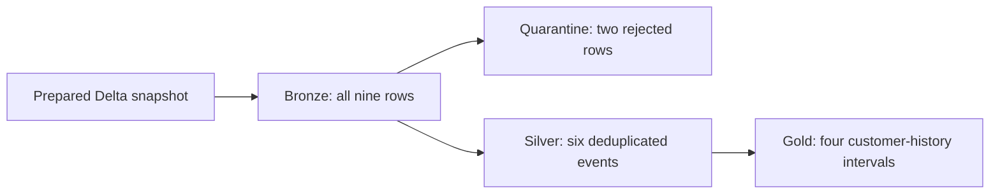

# SDP Code Generation Framework: From Requirements to Tested Medallion Pipelines

## Use case and scope

Data engineers supply mock schemas, sample JSON change records, business rules and expected outputs.
The framework turns one supported customer-history pattern into a reviewable medallion design,
starter Lakeflow Spark Declarative Pipelines implementation, executable unit tests and integration scenarios.
It keeps an explicit architecture review boundary before implementation. No client data or code is used.

The MVP is a Python CLI rather than a hosted application. It supports one fixed schema and rule set;
unsupported requirements fail explicitly. **Development defaults to the interactive Codex session with zero
Unity Gateway calls.** Session-authored architecture, implementation and test-review notes are imported as
review artifacts. The CLI does not invoke or bill a Codex API: the human and Codex prepare those notes here.
The generated executable starter comes from a versioned template. Optional Gateway suggestions stay separate
from executable code. `--backend gateway` must be explicitly selected to use the course model service.

## Development environment

Run from the repository root with Python 3.12, uv and the modern Databricks CLI:

```powershell
uv sync --locked --extra ci
uv run python --version
databricks auth profiles
databricks auth login --host https://dbc-88df4c2c-4033.cloud.databricks.com --profile mvn-llmops-asaijo
uv run python scripts/verify_connection.py --profile mvn-llmops-asaijo
```

The profile name above is an example: select the course profile explicitly. Never use a different workspace.
The repository supplies VS Code interpreter settings and extension recommendations. The Databricks extension
is installed on the development machine. In VS Code, select the course profile and serverless compute,
then run `scripts/verify_connection.py` in the integrated terminal. A successful remote range count proves
connectivity; the presence of an extension alone does not prove it. The included VS Code launch configuration
`Verify course Databricks connection` runs the same tested script with an explicit profile prompt.

`.python-version` pins Python 3.12; `[tool.databricks.environment]` and notebook job environment specifications
pin serverless environment **5**. Databricks Connect remains on major 18, matching environment 5's documented
Connect version. SDP serverless pipeline runtime is platform-managed separately from notebook environments.

## Four-stage workflow

```powershell
# Default backend is codex: import notes prepared in this session, with no Gateway calls.
uv run sdp-framework propose --spec examples/customer_history.json --work-dir work/customer --review-file examples/codex_session_review.json
# Read architecture.json and REVIEW.md; resolve concerns before approval.
uv run sdp-framework approve --work-dir work/customer --reviewer "Atsushi SAIJO" --accept-assumptions
uv run sdp-framework generate --work-dir work/customer --review-file examples/codex_session_review.json
uv run pytest work/customer/generated/test_customer.py -q
```

Approval records a content hash, reviewer and timestamp. Changing any proposal content invalidates it.
The approval command records the user's assertion of review; it is not an identity authentication system.
Generation does not mutate the original proposal. Use a new directory for a new revision.
`--backend codex` is the default, including when a profile is supplied. `--backend template` (or `--offline`)
uses templates without imported review notes. Neither calls Gateway. A short live Gateway smoke test remains
available separately to satisfy the course's service experiment requirement. Explicit `--backend gateway`
on `propose` makes one call and on `generate` makes three calls; those options are not used for normal development.
Gateway requests default to 256 output tokens, allow an explicit cap of 1–1024, and have no automatic retries.

Artifacts include `architecture.json`, `approval.json`, generated SDP code, generated unit tests,
sample events, independently authored expected history, integration scenarios and a hashed manifest.
The manifest initially states `generated_not_executed`; actual pytest reports and workspace job results
are execution evidence. Scenario files are plans and never imply execution.

Inspect generated code before replacing `src/pipelines/customers/transformations/customer_pipeline.py`.
That checked-in file is the reference starter, identical to the generator's supported template;
it does not claim that a live model design has received human approval.

## Data preparation and history semantics

The packaged JSONL fixture contains nine rows: seven valid input rows including one duplicate, and two
invalid rows. Preparation strips whitespace, normalizes operation/email case and converts timezone-aware
timestamps to UTC. It writes a dedicated complete-feed Delta snapshot:
`llmops_dev.asaijo.sdp_prepared_events`. Rerunning replaces only this mock input table.
Schema and small safe sample records are printed. No arXiv notebook was present in the starter repository;
the preparation notebook follows the same load → preprocess → Delta → inspect workflow with mock JSON.

Pipeline dependencies:



This is a **bounded complete-feed batch** design using `pyspark.pipelines.materialized_view`.
It recomputes history from retained source events, so late arrival and replay are deterministic.
It does not implement incremental streaming CDC. The versioned input assumptions require full UPSERT
images, a positive per-customer sequence and strictly increasing timestamps by sequence.
Conflicting event IDs, customer sequences or timestamp ordering fail before writing the snapshot.
Invalid fields are retained in quarantine; losing a bad event may make the resulting history incomplete,
so the quarantine must be reviewed. Empty or invalid-only feeds yield empty history.

Repeated unchanged images do not create new versions. Exact duplicates do not create new versions.
DELETE closes an active interval; deleting an absent customer has no effect. Reinsertion starts a new
version even if attributes match an earlier version. Intervals are UTC `[valid_from, valid_to)`; null
`valid_to` denotes a current record. In the sample C001 changes on January 3, is deleted on January 4,
and is reinserted on January 5. C002 remains unchanged. Expected results are stored independently in
`src/sdp_framework/assets/expected_history.json`.

## Bundle and workspace run

The new job and pipeline are defined under **only the dev target**. Existing acc/prd hello resources remain
as provisioned; the course workflow refuses other environments. No schedule is enabled.
The workflow is `prepare → pipeline → verify → model_experiments` with environment 5 for Python notebook
tasks, the built project wheel, a serverless SDP pipeline, the provisioned usage policy and a one-hour
job timeout. `STANDARD` performance mode is selected because this is a small batch exercise with no latency SLA.
The job parameter `use_gateway` defaults to `false`, so the last notebook exits as **skipped** before creating
any model client. Ordinary preparation, pipeline, verification and replay runs consume no Gateway tokens.

```powershell
uv build
databricks bundle validate --strict -t dev --profile mvn-llmops-asaijo
databricks bundle deploy -t dev --profile mvn-llmops-asaijo
databricks bundle run sdp_course_workflow -t dev --profile mvn-llmops-asaijo
databricks bundle summary -t dev --profile mvn-llmops-asaijo
```

`verify` executes the actual Spark functions against the complete feed, a duplicate replay and reversed
arrival order, compares exact results against the independent fixture, and checks all four deployed tables.
This is separate from the local Python history oracle. A second job run checks repeat refresh behavior;
save both run URLs if performed. Do not use pipeline full refresh to test replay.

When explicitly enabled with job parameter `use_gateway=true`, the experiment notebook makes **one** bounded
course-relevant smoke call and stores only allowlisted experiment fields in
`llmops_dev.asaijo.sdp_model_experiments`. It records prompts/responses, usage,
finish reasons and limitations. `WorkspaceClient` supplies authentication through an HTTP auth adapter
that refreshes SDK credentials per request; no token is embedded in code or persisted in artifacts.
The existing course chat-completions API is retained at `/ai-gateway/mlflow/v1`.
For local experiments:

```powershell
uv run sdp-framework experiment --backend gateway --spec examples/customer_history.json --work-dir work/experiments --profile mvn-llmops-asaijo --max-calls 1 --max-tokens 256
```

## Tests, evidence and open questions

Local tests check exact fixture outputs, normalization, timezone handling, invalid and boundary inputs,
ambiguous events, delete/reinsert semantics, replay, approval enforcement, tamper detection, generated-test
execution, model call stages, renewable authentication and allowlisted experiment fields.
Run `uv run pytest --junitxml=evidence/local-tests.xml`; consult `evidence/status.json` for actual execution status.
Tests with a fake gateway verify client behavior only; they are not live model experiments.

The selected course profile is `mvn-llmops-asaijo`. Remote Spark connectivity, strict workspace bundle
validation and development deployment have been verified. Consult `evidence/status.json` and run evidence
for job and model experiment results. The live architecture proposal in `work/customer-live-review`
remains unapproved; no human approval has been fabricated.
One Gateway architecture call was made before the development-backend preference was clarified. Its actual
usage was 472 prompt tokens + 1800 completion tokens = 2272 total; `finish_reason=length`. The raw structured
response is saved in `evidence/architecture-experiment.json`. It included production assumptions and inaccurate
API/deployment suggestions, illustrating why suggestions need review. The later implementation handles text
content blocks, asks for a concise answer, reduces the cap and makes further calls opt-in.

Questions for course review:

- Is the bounded batch history pattern sufficient for this MVP, or should a later exercise add streaming AUTO CDC?
- Should invalid event handling eventually block publication instead of quarantining and publishing partial history?
- How should a future version resolve conflicting event identities or unordered business timestamps?
- Model-generated tests require independent business expectations; agreement between generator and test is insufficient.
- Live model outputs may be truncated, incomplete or incorrect. Token usage can be absent; it is recorded as null.

The framework does not implement autonomous repair. No PR, push or production deployment was performed.
During validation, the pending Gateway task was canceled to honor the user's revised budget preference;
only that task was then repaired with `use_gateway=false`. Data preparation, Pipeline and verification
had already passed and were not rerun by that repair.

## References

- [Official Databricks agent skills](https://github.com/databricks/databricks-agent-skills)
- [Environment 5: Python 3.12 and Connect 18](https://docs.databricks.com/aws/en/release-notes/serverless/environment-version/five)
- [Lakeflow Python reference](https://docs.databricks.com/aws/en/ldp/developer/python-ref)
- [Unity Gateway model queries](https://docs.databricks.com/aws/en/ai-gateway/query-model-services)
